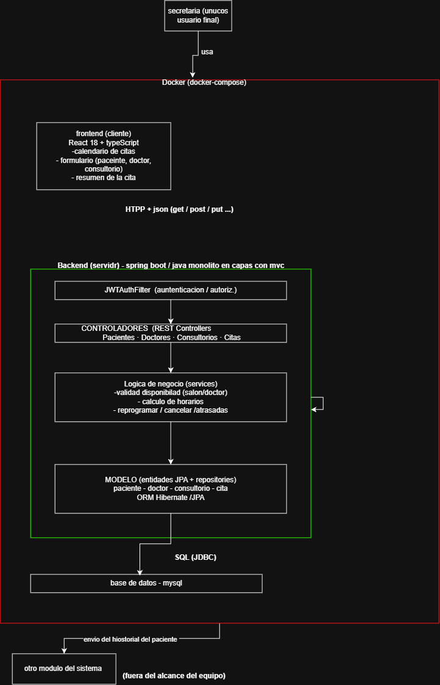
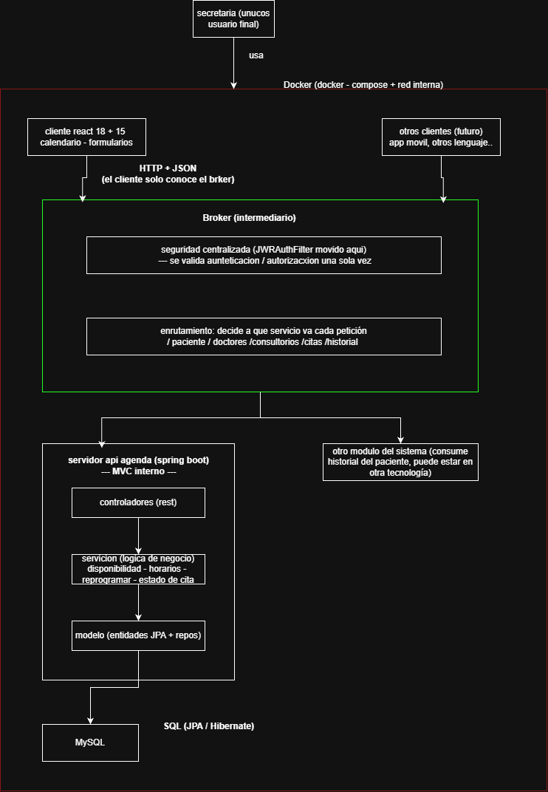
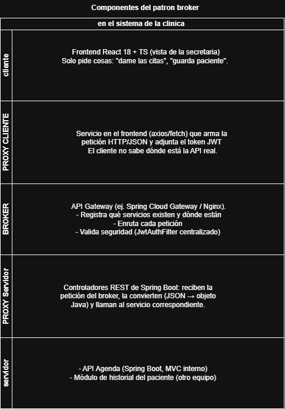
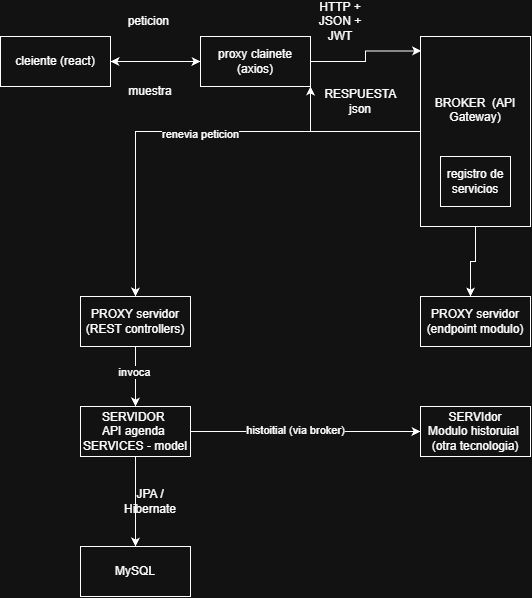
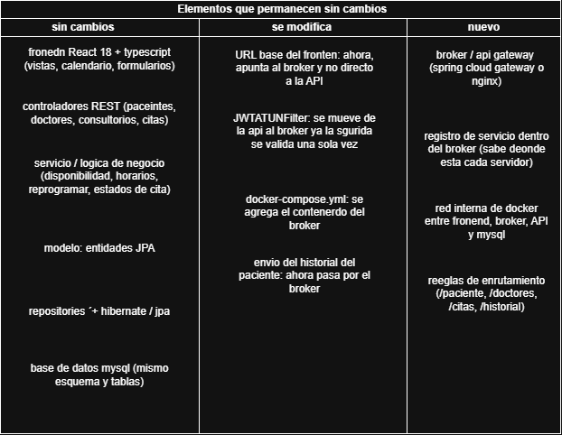

# sistema de agenda de clinica de psicologia 

## contexto

un sitemsa de agenda para la uady, es uso excliusivo par las secretarias ya que son los usuarios finales del sistema las que registran las citas, y a los pacientes que iran a las citas, al igual que registran a los cototers que atendaeran y los consultorios en la que estaran.

# requisitos funcionales

- debes poder resgistrar a un paciente, dicho paciente se guardar aen la base de dato Flujo de ejemplo: el usuario presiona "Comprar", luego el frontend hace POST /pedidos, para uqe la proxima vez este en el listado de paciente.
- debes poder registrar a un doctor, ya que los pacientes seran asiganado a un doctor, el cual sera el cual los atienda 
- debes poder resgistrar a un paciente, dicho paciente se guardar aen la base de dato Flujo de ejemplo: el usuario presiona "Comprar", luego el frontend hace POST /pedidos, para uqe la proxima vez este en el listado de paciente.
- debes poder resstrar la cita, que tiene la informacion del paciente la informacion de la cita que ya puede ser el dia, la hora, en que sala y con que doctor.
- debes poder tener una vista de un calendar, para mostrar las citas y cuales estan pendientes, cuales han sido canceladas, cuales son las que estan en estado de atrasadas.
- El sistema debe mostrar al usuario un resumen final de la cita una vez que se hayan capturado todos los datos necesarios y antes de confirmar o guardar definitivamente la cita.
- El sistema debe validar automaticamente la disponibilidad de los recursos necesarios antes de registrar una nueva cita o reprogramar una cita existente dentro del modulo de agenda.
- aunque no tiene que ver en nuestra parte que se implemento con mi equipo, se hace un envio del historial del paciente para que sea guardada y consumida por otro modulo del sitema 
- se puede reprogramar una cita, por si por x o y el cliente no puedo asistir a su cita o no padra

## usuario principal 

- secretaria: secretaria es la que interactua con el sistema, la que agenda las citas, registra a los pacientes, reguitra a lossoctores y a las consultas. 
- paciente: es el que atravez de la secretaria agrenada la cityya, pero no tiene acceso al sistema, pero podriamos decir que alrededor de su adstraccion en el sitema da vuelta todo 

## tecnologias usadas

- Spring boot 
- java
- mysql
- React 18 + TypeScript
- ORM: Hibernate / JPA
- usamos un contenedor/docker para un despliegue mas sencillo

# arquitectura

tenemos una tipica arquitectua de cliente servidor con las siguientes caracteritica
- se usa el modelo mvc 
    - modelo: en el modelo tenemos principalmente la abtraccion de los usuarioes principales, pero igual tenemos los consultorios, citas
    - vista: tenemos la logica de negocio de la clinica, como los claculos del horario, etc.
    - control: tenemos el control que es el uso y el llamaod para obtenerla infomracin de la ui

 Comunicación: el frontend envía peticiones HTTP en formato JSON a la API. La API consulta la base de datos y devuelve la respuesta.
 es unm molito en capas

## Analisis de arquitectura - sistema clinica psicologica

sabemos que el proyecto desde su disño tiene varios huecos en al parte de arquitectura que debeian ser arreglado, porque una arquitecurr afuertemente basada en mvc, que es una arquitectua que para loq ue necesitavmoa funcionaba, es cuierto porque al fin y al cabo era un CRUD de citas es lo que estavamos haciendo, pero obviamente no tener en ceunta las demas aqrquitecturas y ahora viendo lo en perpectiva te das cuenta que quizas debimos aunque sea condierar una arquitectura diferente a la que tomamos en ese tiempo.

## 2 problemas arquitectonicos 

el problema principal que veo es que quizas en al parte que usamos MVC aunque haya estado fuertemene oreintado a este patron, creo que hubiera sido bueno que se autocompletaran entre si mvc y bbiorker ya que mvc es usado para la estructura interna del proyecto, recibe la peteicion, la procesa con la logica de negocio, accede a los datos de los modelos. Broker en cambio organiza como se hablan las aplicaicones y servicios, asi que la arquitectura objetivo que tendria en este momento seria que como ya dije el MVC se encargue de la parte interna del proyecto la API, pero se incorporan características del patrón Broker: la capa de API actúa como intermediario que desacopla al cliente de los servicios internos, de esta maner descoplamos y el cliente ni elservidor estan conectados direcmtament ni necesitan saber donde estan ni en que lenguuge estan hechos ni nada de eso porque todo eso se encarga el intermediario.
y una ventaja grande que tenenmos al combinar ambos es que podemos combianr difernetes tecnologias gracias a que no importa si el cleinte o el servido usan uina tecnologia o otra porque ellos no tiene la necesidad de conocer eso, eso esta encargado el intermediraio qu eetse caso es la api que usara el modelo o usa el modelo de MVC.

> ahora para que se entienda mejor lo que voy a hacer es una tabla comparatica para que se entiendan los diferenten patrones arquitectonico

## 3 Comparación de alternativas 

| criterio                              | broker | MVC | Reflection   | 
|------------------------------------   |-----|-----|-----|
| ¿Resuelve el problema identificado?   | si, este seria una de las opciones qu epodriamousar para resolver nuestro problema, ya qeu seria una copmbinacion de dos patrones mvc y broker ya que en un pryecto grande es muy normal que se use mas de un patron arquitectonico, por lo que en una propueta pra resolverlo seria poder combinar el mvc para la api y broker para inmtereacion entre cliente y servidor  | no, a mendiaas porque este patron de arquitectura ya esta implenmtado asi que se pude decir que resuelve el problema del sistema, pero se habla de el problema con el sistema tal como esta pues no porque ya esta implementado | no | 
| Atributos favorecidos                 | este favorece a la felexiblidad en tencoligas y concexiones ya que como estan separado el cleitne y el servidor no importa el lenguage, la logica si no la comuncion entre componentes distribuidos  | el atributo favorecido es que tenemos separa la inertafz, entrad de datos y logica dentro de la aplicaiocn   | en nuestro sistema no encaja porque las reglas ya estan deifindinas en codgio, tambien porque el estado de la ciea es un conjunto cerrado  | 
| Beneficios                            | el desacloplamietno/flexiblidad | Separación de responsabilidadesm, matenebilidad, facilidad de prueba  | te ayuda a ser max felexible a cambios de feature en produccion, evitando tanto cambio de codigo | 
| Limitaciones                          | tiene un cuello de botella ya que todo pasa por el, el sitema se ahce dependiete de si el brojer cae se detiene el sistema | sobre ingenieria en sitemas pequeños no es necesario ya que teiene mas archivos d elo s que en verdad se necesita,  no define cómo se comunican procesos o servidores distintos.  | menor rendimiento, muchos errores aparecen en ejecución, no al compilar.apareces  | 
| Complejidad agregada                  | complejidad de depuracion, es mas compliacdo seguir una peticion entre varios componenetes | no resulve como se comuncan processo atravez de servidores distintos  | el código es menos legible y más difícil de probar. | 
| Viabilidad en el sistema    !nota esto en sitemas grandes          | es muy viable y es necesario en sitemas grandes y distribudis, que usan muchas tecnologias | muy viable es el estandar en paginas web grandes modernas | esta es viable pero en agunos casos especificos,, como comentaba de saber que los requsiutos cambiaran mas de una vez, pero ew complejo de mantener por lo que es el menos viable en sistemas grandes  | 

## 4  Selección del patrón Seleccionen un patrón y respondan: broker 
1. ¿Qué problema resuelve? 

    el prblema que resuelve es la conexcion entre el servidor y el cleitne, lo hace mas flexible puedindo conectar diferentes componentes
2. ¿Por qué es mejor que las otras alternativas? 

    no diria que es mejor, depende a que contexto del sistema tengas, pero su ventaja es comunicar componenetes distribuidos enstre aplicaciones o procesos
3. ¿Qué componentes deben incorporarse? 

    el cliente, el servidor y el broker
4. ¿Qué componentes actuales deben modificarse? 

    JwtAuthFilter, pasar a aqui la centrarlizacion de la auntenticacion y autorizacion, ya que el brojer validad la segruidad solo una vez
    en docker-compose.yml, añafir la configuracion de red entre fronted, API y mysql
5. ¿Qué atributos de calidad favorece?

    compatibilidad: faviore a este atributo de calidad dado a que se puede contar con mas tecnologias, por lo que puede ser mas compatible para diferentes servidores
    Adecuación funcional: dado a lo mismo se uede adecuar a diferentes servidores

6. ¿Qué riesgos introduce? 

    dado a que esta sentralizado si el broker cae el sistema cae por lo que eso puede traer problemas, el cuello de botella ya ue todo el trafico pasa por el, 
7. ¿Qué atributo podría verse afectado negativamente? 

    yo creo que el atributo que ma se pordira ver afectado es la mantenibilada del sistema

## 5 Diagramas

### Arquitectura actual

### Arquitectura propuesta

### Componentes del patrón

### Relaciones entre componentes

### Elementos que permanecen sin cambios

