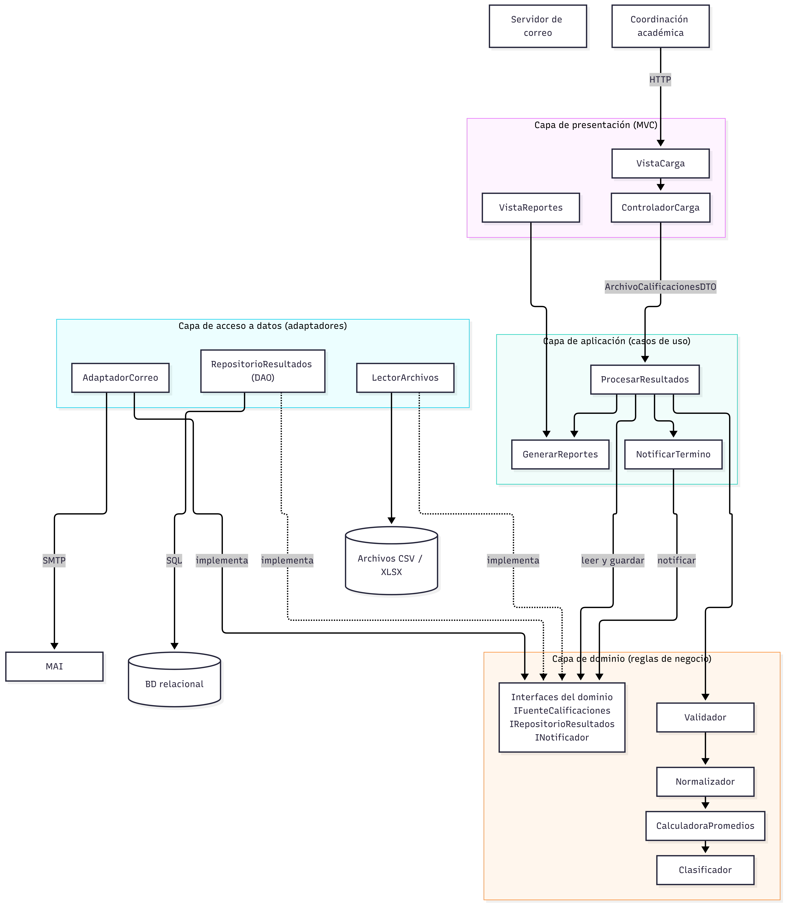
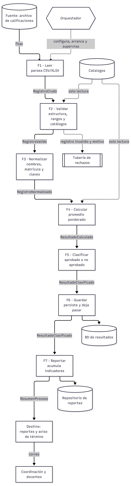
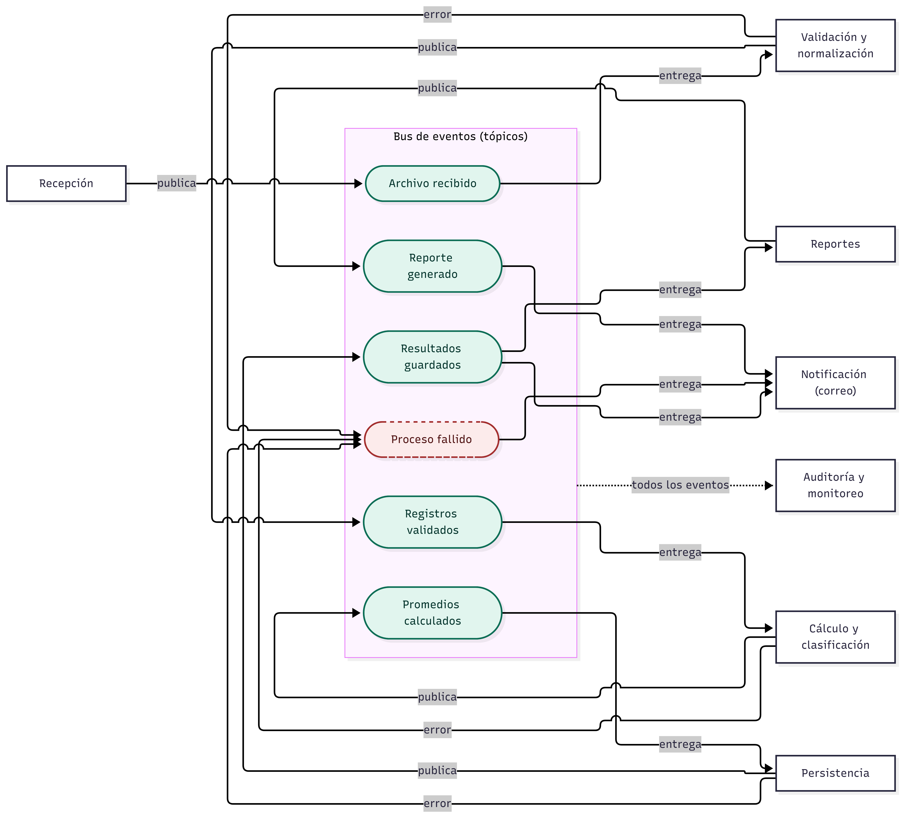

# Actividad 3. Un mismo sistema con tres estilos arquitectónicos

**Arquitectura de Software** - FMAT-UADY
**Equipo:** César Dzul, Diego Gervacio, Daniel Cauich, Juan Miranda
**Fecha de entrega:** 31 de octubre de 2026

---

## Caso de estudio y supuestos

El sistema procesa resultados académicos, es decir, recibe archivos de calificaciones, valida y normaliza los registros, calcula promedios, identifica aprobados y no aprobados, guarda los resultados, notifica la terminación del proceso de archivo de calificaciones y genera reportes. Los requisitos funcionales son idénticos en las tres alternativas, lo que cambia es la organizacion y, por lo tanto, sus consecuencias sobre los atributos de calidad.

Como equipo definimos un contexto base para poder comparar y seleccionar las alternativas: (esto fue ya que no había descripción en las instrucciones)

| Aspecto | Supuesto del contexto base |
|---|---|
| Volumen | ≈ 3,000 estudiantes × 6 asignaturas ≈ 18,000 registros por corte |
| Frecuencia | 3 cortes por semestre (2 parciales y final), más reprocesos por correcciones |
| Entrada | Archivo CSV/XLSX (valores separados por columnas), un registro por estudiante-asignatura: matrícula, nombre, clave de asignatura, grupo, periodo y calificaciones de cada evaluación |
| Regla de aprobación | Promedio ponderado >= calificación mínima configurable (ejemplo: 70/100), las ponderaciones vienen del catálogo de asignaturas |
| Infraestructura | Servidor institucional, BD relacional y servidor de correo, sin broker de mensajería |
| Equipo | 4 integrantes con experiencia en capas y MVC, poca experiencia en mensajeria asíncrona |

---

## 1. Diseño de las alternativas

### 1.1 Alternativa A. Arquitectura en capas

**Idea.** Organizar el sistema por niveles de responsabilidad. Cada capa ofrece servicios a la de arriba mediante un contrato y solo usa a la capa inmediata inferior. Para que la persistencia sea sustituible, el dominio define las interfaces IFuenteCalificaciones, IRepositorioResultados e INotificado, y la capa de acceso a datos las implementa, de esta forma la logica de negocio depende del contrato y no de una tecnologia concreta

**Componentes y responsabilidades**

| Capa | Componentes | Responsabilidad |
|---|---|---|
| Presentación (MVC) | VistaCarga, ControladorCarga, VistaReportes | Subir el archivo, mostrar avance y resumen, descargar reportes. Sin reglas de negocio. |
| Aplicación | ProcesarResultados, GenerarReportes, NotificarTermino | Casos de uso: como orquestar la secuencia, manejar la transaccion y traducir errores. |
| Dominio | Validador, Normalizador, CalculadoraPromedios, Clasificador; entidades RegistroCalificacion y ResultadoAcademico | Reglas de negocio: como validación, normalización, promedio ponderado y criterio de aprobación. |
| Acceso a datos | LectorArchivos, RepositorioResultados (DAO), AdaptadorCorreo | Leer CSV/XLSX, persistir en la BD y enviar correo; implementan las interfaces del dominio. |

**Conectores.** HTTP entre navegador y presentación, llamadas locales a métodos a través de interfaces con DTO entre capas, SQL/JDBC hacia la BD, SMTP hacia el servidor de correo, sistema de archivos para la entrada.

**Flujo de información**

1. La coordinación sube el archivo en VistaCarga, ControladorCarga arma un ArchivoCalificacionesDTO.
2. ProcesarResultados abre una unidad de trabajo e invoca al dominio en secuencia: leer → validar → normalizar → calcular → clasificar.
3. El dominio obtiene los registros mediante IFuenteCalificaciones (implementada por LectorArchivos) y valida las claves contra los catálogos.
4. La aplicacion solicita IRepositorioResultados.guardar(resultados) y confirma la transacción.
5. La aplicación invoca INotificador.notificarTermino(resumen) y GenerarReportes.generar(idProceso).
6. La respuesta (ResumenProcesoDTO) sube capa por capa y la vista muestra totales, rechazados y el enlace al reporte.

**Entradas y salidas**

| Capa | Entrada | Salida |
|---|---|---|
| Presentación | Archivo y periodo elegidos por el usuario | ArchivoCalificacionesDTO; pantalla con el resumen |
| Aplicación | ArchivoCalificacionesDTO | ResumenProcesoDTO (total, válidos, rechazados, aprobados, no aprobados, estado) |
| Dominio | Lista de RegistroCalificacion | Lista de ResultadoAcademico + lista de rechazos con motivo |
| Acceso a datos | Ruta del archivo, resultados, resumen | Registros leídos, filas en BD, correo enviado |

**Contrato del servicio principal**

```text
Servicio:      procesarArchivo
Entrada:       ArchivoCalificacionesDTO { archivo, periodo, usuarioCarga }
Salida:        ResumenProcesoDTO { idProceso, total, validos, rechazados, aprobados, noAprobados, estado }
Precondición:  usuario con rol de coordinación, archivo CSV/XLSX, periodo abierto
Postcondición: resultados registrados en BD, aviso enviado, reporte disponible
Errores:       FormatoInvalido (400), PeriodoCerrado (409), ErrorPersistencia (500)
```

**Manejo de errores**

- **Archivo inválido** por formato o columnas faltantes: se rechaza en la precondicion, antes de procesar, y el usuario ve el motivo.
- **Registro inválido:** no detiene el proceso, el dominio lo agrega a una lista de rechazos. Si los rechazos superan un umbral, el caso de uso aborta y pide corregir el archivo
- **Fallo de persistencia:** la transacción se revierte completa, sin dejar resultados parciales, el proceso queda como "fallido" y puede reintentarse con el mismo idProceso
- **Fallo de notificación:** no revierte resultados que ya se guardaron, se registra y se reintenta.
- Cada capa traduce las excepciones de la capa inferior a su propio nivel de abstracción (SQLException → ErrorPersistencia → mensaje comprensible en la vista).

**Diagrama A**



---

### 1.2 Alternativa B. Pipes & Filters

**Idea.** El procesamiento se organiza como una línea de producción, en esta cada filtro hace una sola transformación, no conoce a sus vecinos y solo depende del formato de datos que recibe y entrega. Las tuberías transportan los datos sin alterarlos y conservan su orden. Un orquestador arma la tubería a partir de una configuracion, la arranca y recibe las señales de error, pero no procesa datos

**Componentes, responsabilidades, entradas y salidas**

| Elemento | Responsabilidad | Entrada -> Salida |
|---|---|---|
| Fuente | Archivo de calificaciones | Sin entrada -> filas del archivo |
| F1 Leer | Parsear CSV/XLSX, una fila por registro | filas -> RegistroCrudo |
| F2 Validar | Campos obligatorios, rango 0–100, formato de matrícula, clave existente en catálogo | RegistroCrudo -> RegistroValido (inválidos -> tubería de rechazos) |
| F3 Normalizar | Nombres (espacios, mayúsculas, acentos), matrícula y claves en formato estándar | RegistroValido -> RegistroNormalizado |
| F4 Calcular | Promedio ponderado dependiendo de las espcificaciones de la asignatura | RegistroNormalizado -> ResultadoCalculado |
| F5 Clasificar | Comparar con la calificación minima, esto dara aprobado o no aprobado | ResultadoCalculado -> ResultadoClasificado |
| F6 Guardar | Persistir por lotes en la BD y dejar pasar el dato | ResultadoClasificado -> ResultadoClasificado |
| F7 Reportar | Acumular indicadores por grupo y asignatura, todo al terminar el flujo | ResultadoClasificado -> ResumenProceso + reportes |
| Destino | Repositorio de reportes y aviso de término a coordinación y docentes | ResumenProceso -> Sin entrada |

**Conectores** En el contexto base son streams ( flujo de datos que lee o escribe información directamente en la RAM) en memoria dentro de un mismo proceso, si se necesita de concurrencia, se usan colas acotadas entre hilos. Cada tubería tiene un contrato que es el tipo de dato que transporta. Ademas hay una tubería de rechazos y accesos de solo lectura a los catálogos 

**Flujo de información** La fuente entrega filas a F1, cada filtro consume un registro de su tubería de entrada, lo transforma y lo escribe en la de salida, de modo que varios registros avanzan al mismo tiempo en distintas etapas. Al terminar el archivo se propaga una señal de fin de flujo: F6 confirma el último lote, F7 genera los reportes y el destino envía el aviso de término

**Manejo de errores**

- **Error de dato** registro inválido: F2 lo desvía a la tubería de rechazos con línea y motivo, y el flujo principal continúa. Se genera un archivo de errores que se devuelve a quien hizo la carga.
- **Error técnico de un filtro**: el filtro avisa al Orquestador, que detiene la tubería. Como F1–F5 no tienen estado, reprocesar es seguro, F6 inserta de forma idempotente (clave: periodo + matrícula + asignatura), así que un reintento no duplica resultados
- **Puntos de control:** con volúmenes grandes se guarda la salida de F5 en un archivo intermedio para reanudar desde ahí sin repetir las primeras etapas.
- **Riesgo propio del estilo:** una falla en un filtro impide que el flujo completo produzca un resultado y por eso la deteccion y el reintento se manejan en el orquestador y no dentro de cada filtro

**Diagrama B**



---

### 1.3 Alternativa C. Publicador–Suscriptor

**Idea.** Los componentes no se llaman entre sí, anuncian eventos en un bus y se suscriben a los que les interesan. El publicador no conoce a sus suscriptores ni cuantos hay, esta infraestructura garantiza que cada evento llegue a todos los suscriptores de ese evento.

Como el enunciado define cinco eventos, la normalización se asignó al servicio de Validación (publica registros ya validados y normalizados) y la clasificación al servicio de Cálculo (publica promedios ya clasificados). Además se agregó un evento de error, Proceso fallido.

**Componentes y responsabilidades**

| Componente | Se suscribe a | Responsabilidad | Publica |
|---|---|---|---|
| Recepción | — (carga web) | Guardar el archivo y asignar idProceso | Archivo recibido |
| Validación | Archivo recibido | Leer, validar y normalizar | Registros validados o Proceso fallido |
| Cálculo | Registros validados | Calcular promedios y clasificar | Promedios calculados |
| Persistencia | Promedios calculados | Guardar en BD | Resultados guardados |
| Reportes | Resultados guardados | Generar reportes | Reporte generado |
| Notificación | Resultados guardados, Reporte generado, Proceso fallido | Avisar término, enviar enlace al reporte o avisar la falla |  |
| Auditoría | Todos los eventos | Bitacora y estado de cada proceso por idProceso |  |

**Conector.** Bus de eventos con temas, con rol de anuncio para publicadores y de escucha para suscriptores. Cada evento sigue un esquema versionado: { idEvento, tipo, idProceso, fecha, version, datos }. Como un lote tiene miles de registros, el evento lleva una referencia al lote intermedio (su ubicación en almacenamiento) y no los datos completos, para que el bus transporte mensajes pequeños.

**Flujo de información.** Recepción publica Archivo recibido -> Validación lo consume y publica Registros validados -> Caculo publica Promedios calculados -> Persistencia publica Resultados guardados, evento que atienden dos suscriptores en paralelo (Reportes y Notificación) -> Reportes publica Reporte generado -> Notificación envía el enlace. Auditoría escucha todos los eventos. La comunicación es asíncrona, el usuario recibe de inmediato un "archivo recibido, folio X" y el resultado llega despues

**Entradas y salidas.** La única entrada externa es el archivo , las salidas externas son la BD, los reportes y los correos. Entre los componentes solo viajan eventos

**Manejo de errores**

- No hay respuesta directa al publicador, los errores se publican como eventos a los que se suscriben Notificación y Auditoría.
- Entrega al menos una vez"con reintentos y una cola de mensajes fallidos para eventos que no pudieron procesarse
- Suscriptores idempotentes, registran el idEvento procesado para no duplicar resultados si un evento llega dos veces
- idProceso funciona como identificador de correlación para reconstruir la traza, un supervisor marca como atascado un proceso que no recibe Resultados guardados dentro de un tiempo limite
- Consecuencia, consistencia eventual, por un tiempo los reportes pueden no reflejar todavía lo que ya se guardó

**Diagrama C**



Los servicios no se llaman entre si, cada uno publica un evento en el bus y el bus lo entrega a quienes están suscritos. El evento Resultados guardados tiene dos suscriptores, lo que muestra que un mismo evento puede ser atendido por varios componentes a la vez. Las flechas punteadas hacia Proceso fallido son publicaciones de error, y Auditoria está conectada al bus completo porque se suscribe a todos los eventos para reconstruir la traza de cada proceso por su idProceso.

---

## 2. Cuadro comparativo


| Criterio | Capas | Pipes & Filters | Publicador–Suscriptor |
|---|---|---|---|
| Facilidad de comprensión | Estructura jerárquica que el equipo ya conoce, cada capa tiene un propósito claro. La secuencia del proceso, aunque queda oculta dentro del caso de uso. | El diagrama es el proceso, se lee como una línea de producción y cada filtro tiene un nombre del negocio | El flujo es implícito, para saber qué pasa después de un evento hay que buscar quién está suscrito. |
| Mantenibilidad | Cambiar la BD o la vista es localizado gracias a los contratos, pero agregar o reordenar pasos obliga a modificar el caso de uso | Agregar, quitar, sustituir o reordenar un filtro tiene impacto limitado, el único acuerdo entre filtros es el formato de cada tubería | Agregar suscriptores no toca al publicador, pero cambiar el esquema de un evento afecta a todos sus suscriptores |
| Rendimiento | Llamadas locales en memoria, sin serialización ni intermediarios | Cada tubería agrega transferencia y buffers, lo compensa la ejecución concurrente de etapas | Cada paso pasa por el bus. lo que hace que la latencia total sea mayor y menos predecible |
| Escalabilidad | Se puede replicar la aplicación completa repartiendo archivos, pero no escalar solo la etapa costosa, en este caso la BD compartida limita | Las etapas sin estado se ejecutan en paralelo o con varias instancias, se escala solo el filtro que es un cuello de botella | Varias instancias de un suscriptor consumen del mismo tópico, aunque productores y consumidores escalan por separado |
| Reutilización | Dominio y acceso a datos se reutilizan mediante sus contratos, pero los casos de uso son específicos de este | Un filtro autocontenido puede participar en otras tuberías sin cambios | Nuevos consumidores reutilizan eventos existentes, pero cada servicio queda atado al esquema de los eventos que consume. |
| Facilidad de pruebas | Cada capa se prueba con dobles de la inferior gracias a las interfaces | Cada filtro se prueba con una entrada conocida y su salida esperada, la tubería completa con archivos de muestra | La asincronía, el orden no determinista y la dependencia del bus dificultan reproducir fallas |
| Manejo de errores | Las excepciones suben por la pila de llamadas, el contrato declara los errores y la transacción permite revertir todo. | Los datos inválidos se resuelven con la tubería de rechazos, pero una falla técnica detiene el flujo | No hay respuesta directa, se necesitan eventos de error, reintentos, cola de fallidos, etc |
| Complejidad | Un solo despliegue, llamadas síncronas y tecnologia | Hay que definir el formato de cada tubería, el orquestador, la señal de fin de flujo y la concurrencia. | Bus, tópicos, esquemas versionados, garantías de entrega, etc |

En resumen podemos decir que capas gana en simplicidad, rendimiento y manejo de errores, que Pipes and Filters gana en mantenibilidad, reutilización, pruebas y escalabilidad y que Publicador–Suscriptor solo destaca en escalabilidad y desacoplamiento, aunque tiene un costo alto en complejidad y trazabilidad.

---

## 3. Selección de la alternativa

**Decisión: Pipes and Filters.**

El problema central del sistema es transformar un flujo de registros mediante una secuencia fija de pasos, que es exactamente el tipo de problema para el que existe Pipes & Filters

Como el sistema también tiene una interfaz para cargar archivos y consultar reportes, y necesita acceder a la base de datos, la tubería se ubica dentro de la capa de aplicación de una estructura en capas sencillo, esto no cambia la eleccion, las capas solo separan la interfaz y la persistencia, mientras que la organización que resuelve el problema principal es la tubería de filtros

| Factor | Contexto base | Implicación | Favorece |
|---|---|---|---|
| Volumen de registros | ≈ 18,000 por corte | Volumen moderado, cualquier estilo lo procesa, la tuberia procesa en flujo sin cargar todo en memoria | Capas / P&F |
| Frecuencia del proceso | 3 cortes por semestre más reprocesos | Proceso por lotes, no en tiempo real, la asincronia de Pub/Sub no aporta | P&F |
| Necesidad de cambios | Reglas de validación y ponderaciones cambian entre periodos y planes de estudio | El cambio debe quedar confinado a una etapa | P&F |
| Posibilidad de reutilizar etapas | Validación y normalización sirven a otros procesos | Filtros autocontenidos y reutilizables | P&F |
| Procesamiento paralelo | Es deseable si crece el volumen | Etapas sin estado paralelizables sin rediseño | P&F |
| Experiencia del equipo | Domina capas y MVC, no mensajería | Evita la  curva de aprendizaje y riesgo operativo | Capas / P&F en memoria |
| Infraestructura disponible | Servidor, BD y correo | Pub/Sub exigiría instalar y operar un bus | Capas / P&F |

Los factores en los que Capas y Pipes & Filters empatan ¿son los que descartan a Publicador–Suscriptor, los que desempatan favorecen a Pipes an Filters.

---

## 4. Análisis de cambios de contexto

### 4.1 Se procesan 100 registros por semana

El verdadero problema no es el volumen volumen o el paralelismo, lo que importa es la simplicidad y el bajo costo de mantenimiento. Lo que hace que la elección cambie, conviene una arquitectura en capas simple, con los pasos como métodos bien separados dentro del dominio.

### 4.2 Se procesa un millón de registros diariamente

La elección se mantiene y se refuerza, donde las tuberías pasan a ser colas, las etapas sin estado corren con varias instancias, se particiona por clave y F6 inserta por lotes. Capas monolítico se vuelve cuello de botella porque solo escala replicando todo y Publicador también escalaría, pero con más latencia por evento y peor trazabilidad

### 4.3 Las reglas de validación cambian cada mes

El estilo no cambia, Pipes ya confina el cambio en F2. Para no recompilar cada mes, F2 se convierte en un motor generico que lee las reglas desde un repositorio. Es la idea del patrón Reflection, el riesgo es que una regla mal configurada rechace registros válidos

### 4.4 Diferentes sistemas necesitan reutilizar la validación

Si los otros sistemas usan la misma tecnología y se ejecutan en el mismo proceso, basta reutilizar F2 como componente. Si son sistemas distintos, en otros servidores o tecnologías, la validación se expone como servicio con contrato y se accede mediante el patrón Broker. El estilo base no cambia, F2 se convierte en un adaptador que llama al servicio y las reglas quedan en un solo lugar. El sacirificio es la latencia por llamada remota y que un broker que puede volverse punto central de falla

### 4.5 Los resultados deben notificarse a cinco aplicaciones

En este caso nos decidimos a Publicador–Suscriptor, un productor y varios consumidores que no deben acoplarse a él. Como para notificar a cinco aplicaciones de todos modos se necesita un bus de eventos, desaparece la restricción de infraestructura que nos hizo descartar este estilo. Las cinco aplicaciones se suscriben al evento Resultados guardados y agregar una sexta no modifica al sistema. A cambio, aumenta la complejidad y el manejo de errores se vuelve mas elaborado, lo que se atiende con idProceso en cada evento, reintentos, suscriptores idempotentes y cola de fallidos.

---

## 5. Conclusión individual

**César Dzul**

Esta actividad me dejó claro que los requerimientos funcionales no deciden la arquitectura. Aunque las tres alternativas procesan el mismo archivo y calculan los mismos promedios, cada una asume un costo distinto, el diseño en capas es directo y fácil de depurar, Pipes and Filters facilita modificar o reciclar etapas a cambio de un poco de latencia y el modelo Publicador-Suscriptor ofrece un desacoplamiento total, pero hace más el manejo y rastreo de errores.

Lo que realmente definio la decisicion fueron los atributos de calidad que exige el proyecto. Para un volumen de datos manejable donde las reglas cambian seguido, la mejor opcion es un pipeline integrado dentro de una arquitectura en capas. Hacer el ejercicio de cambiar el escenario fue algo importante, si solo procesas cien registros a la semana, la mejor ruta es la más simple, pero si tienes cinco aplicaciones consumiendo la información, usar eventos deja de ser sobreingeniería.

He aprendidoe que los estilos arquitectónicos se combinan según el alcance del problema, y que toda decisión técnica debe documentarse junto con sus sacrificios para poder reevaluarla sin problemas cuando el contexto del negocio cambie.

**Diego Gervacio**

El desarrollo de esta actividad permitió comprobar que un mismo conjunto de requisitos funcionales admite varias soluciones arquitectónicas válidas, y que la diferencia entre ellas está en los atributos de calidad que cada una favorece o sacrifica. El cuadro comparativo fue la herramienta mas útil para hacer visible esa diferencia, ninguna alternativa obtuvo valoraciones altas en todos los criterios, lo que confirma que toda decisión arquitectónica implica un sacrificio.

La selección de Pipes & Filters no se basó en preferencias personales, sino en factores concretos del contexto, el proceso es por lotes, las reglas de validación cambian con frecuencia y algunas etapas pueden reutilizarse en otros procesos. Asimismo, el análisis ayudó a identificar riesgos que no eran evidentes al principio, como que la falla de un solo filtro puede detener todo el flujo.

Gracias a esta actividad he entenido que una arquitectura no se elige una sola vez, sino que debe revisarse cuando cambian el volumen, la frecuencia o el numero de consumidores, tal como se observó en el análisis de cambios de contexto.

**Juan Miranda**

Al principio, cuando leímos el caso, yo pensaba que Publicador-Suscriptor iba a ser la mejor opción porque es el estilo que más se ve en sistemas modernos. Conforme fuimos llenando el cuadro comparativo me di cuenta de que para este problema no tenía mucho sentido y es que el proceso es una secuencia fija, cada etapa tiene un solo consumidor y el equipo no tiene experiencia con mensajería, asi que íbamos a pagar mucha complejidad sin necesitarla.

Lo interesante fue ver que al analizar los cambios de contexto, ese mismo estilo terminó siendo la mejor opción cuando los resultados tienen que llegar a cinco aplicaciones. Eso me hizo ver que un estilo es mejor o no dependiendo del problema y de lo que el sistema necesita en ese momento.

Esta actividad me ha hecho aprender que las decisiones de aquitectura se toman por los atributos de calidad que de verdad importan en el proyecto

**Daniel Cauich**

Lo que aprendí de la actividad fue el manejo de errores, porque es donde las tres alternativas se diferencian más. En capas basta con propagar excepciones y revertir una transacción, en Pipes & Filters hay que pensar en una tubería de rechazos, en un orquestador y en inserciones idempotentes para poder reprocesar y en Publicador-Suscriptor ni siquiera existe una respuesta directa, por lo que los errores se vuelven eventos que otro componente tiene que escuchar.

Tambien me pareció valioso ver cómo una buena decisión inicial facilita los cambios posteriores. Al tener la validación aislada en un filtro, fue sencillo plantear que sus reglas se configuren cada mes o que otros sistemas la consuman como servicio por medio de un Broker, sin rediseñar el resto del procesamiento.

En conclusión, aprendí que la calidad de una arquitectura se nota más en cómo responde a fallas y cambios que en el caso ideal y que esos escenarios deben pensarse desde el diseño y no cuando el sistema ya está en produccion.

---

## Referencias

- Menéndez Domínguez, V. H. *Estilos arquitectónicos* (Unidad 2). Arquitecturas de Software, FMAT-UADY.
- Menéndez Domínguez, V. H. *Patrones arquitectónicos: Broker, MVC y Reflection*. Arquitecturas de Software, FMAT-UADY.
- *Arquitectura de Software y Calidad: atributos de calidad, escenarios, ISO/IEC 25010 y ATAM*. Material del curso, septiembre de 2026.
- Buschmann, F., Meunier, R., Rohnert, H., Sommerlad, P. y Stal, M. (1996). *Pattern-Oriented Software Architecture, Vol. 1: A System of Patterns*. Wiley